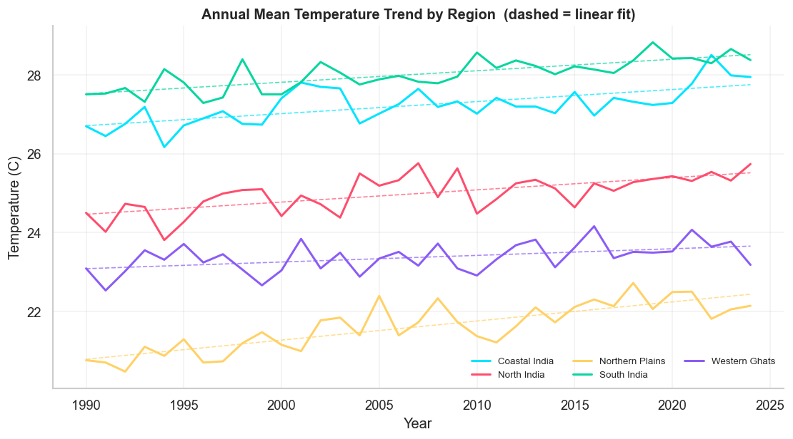
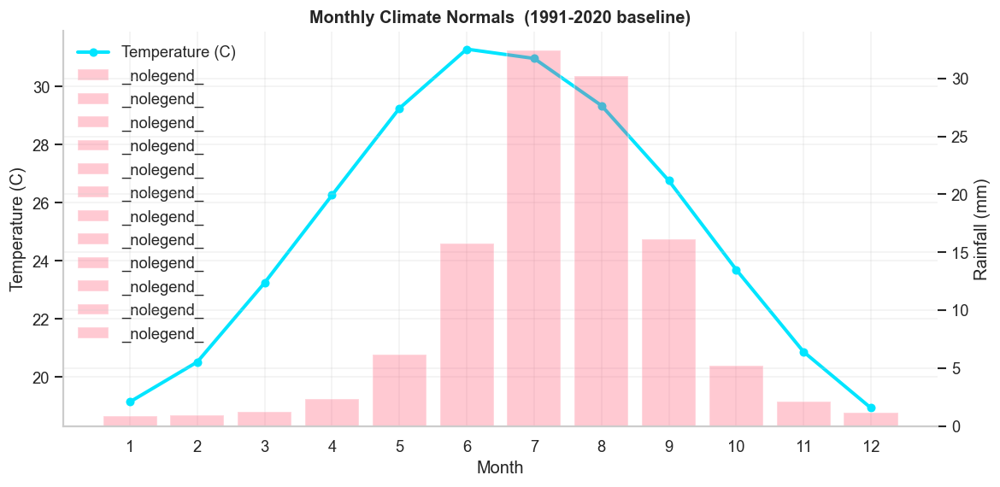
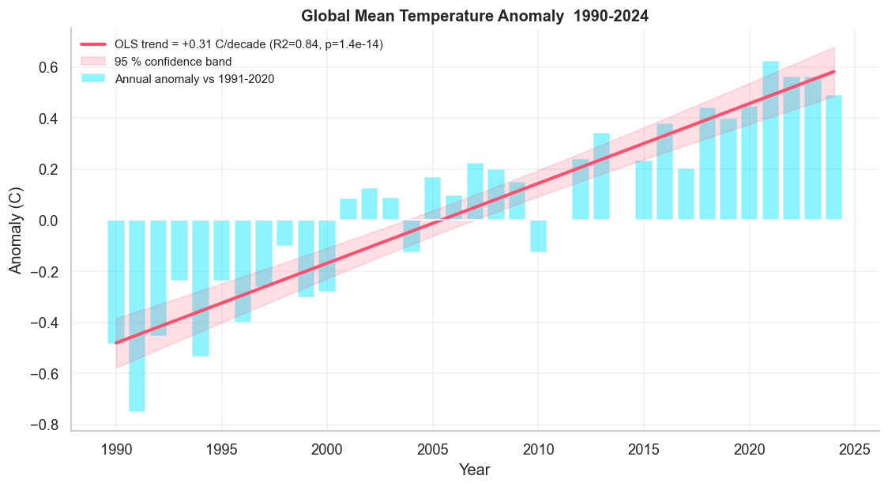
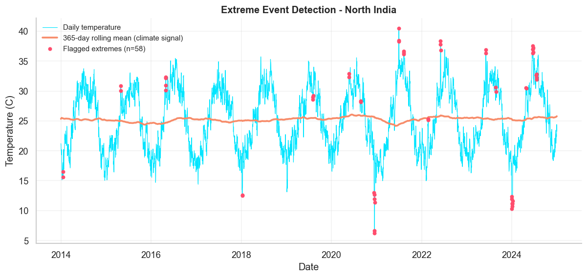
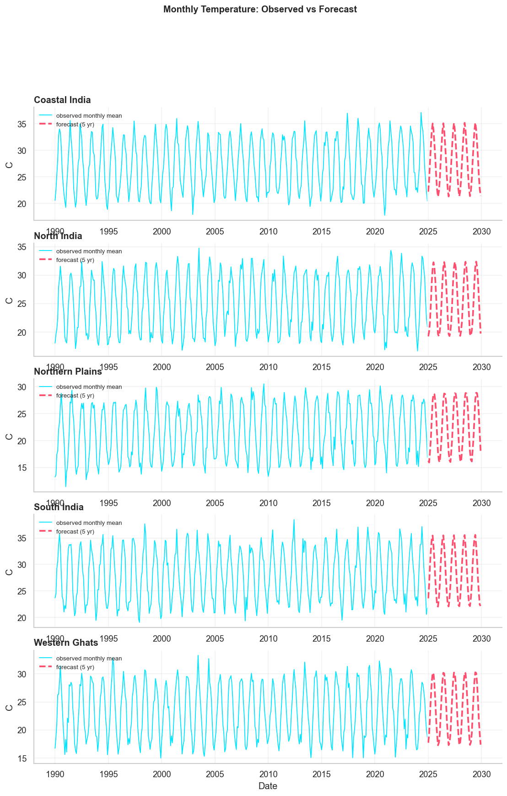

# CLIMATE TREND ANALYZER

**statistical analysis &#183; anomaly detection &#183; forecasting &#183; virtual simulation 1990-2024**

**author: Harsha K S**


---

## 1. OVERVIEW

**Climate Trend Analyzer** is an end-to-end data science project that takes raw,
messy, daily climate records and turns them into defensible statistical
evidence:

* long-term warming trends per region (OLS + Theil-Sen + Mann-Kendall)
* seasonal shifts (is the centre-of-heat day moving?)
* extreme-event detection (heatwaves, cold snaps, floods) with measurable
  precision / recall against ground truth
* 5-year temperature forecasts with an honest 24-month backtest
* CO2 and sea-level projections
* an animated 3D Streamlit dashboard and an automated markdown report

Because public climate APIs are hard for students to access reliably, the
project ships a **virtual simulation engine** that generates physically
plausible records (seasonality, warming trend, monsoon, AR(1) weather noise,
injected extreme events, sensor errors) with a fixed random seed - so every
machine reproduces the exact same dataset.

---

## 2. PROBLEM STATEMENT

Governments and agencies need to answer questions like:

1. how fast is each region warming, and is the trend statistically significant?
2. are extreme heat / rainfall events becoming more frequent?
3. what does the next 5-10 years look like on the current trajectory?
4. can we detect anomalies early enough to act?

Doing this manually with spreadsheets is slow, error-prone and impossible to
audit. This project automates the full path **raw data -> cleaned data ->
statistical evidence -> visual story -> report**.

---

## 3. INDUSTRY RELEVANCE

| sector | how this skill set is used |
| --- | --- |
| environmental consulting | climate risk assessments for infrastructure clients |
| energy / utilities | demand forecasting driven by temperature trends |
| agritech | monsoon and heat-stress forecasting for sowing windows |
| public policy | evidence packs for heat-action plans and city budgets |
| climate-tech startups | anomaly pipelines for satellite and sensor fleets |
| research institutes | reproducible analysis notebooks + statistical testing |

Organisations such as the UN, NASA, IMD, NOAA and climate-analytics startups
all run variants of this exact pipeline at larger scale.

---

## 4. TECH STACK

| layer | tool | why |
| --- | --- | --- |
| language | Python 3.10+ | industry default for data science |
| data | pandas, numpy | cleaning, aggregation, features |
| statistics | scipy, statsmodels | OLS, Theil-Sen, Mann-Kendall, Holt-Winters |
| machine learning | scikit-learn | IsolationForest anomaly detection |
| static charts | matplotlib, seaborn | report-quality PNGs |
| interactive charts | plotly | 3D surfaces, animated frames |
| dashboard | streamlit | instant web UI, no front-end code |
| testing | pytest | 26 pipeline + 10 dashboard tests |
| notebook | jupyter | narrative walkthrough |

No GPU is required. The full pipeline runs on a laptop CPU in about 60 seconds.

---

## 5. ARCHITECTURE

```
        +-------------------+
        |  SIMULATION       |  src/simulation.py
        |  virtual dataset  |  daily rows, 5 regions, 1990-2024
        +---------+---------+
                  | data/raw/climate_raw.csv
                  v
        +-------------------+
        |  PREPROCESSING    |  src/preprocessing.py
        |  clean + features |  dedupe, repair, interpolate, normals, anomalies
        +---------+---------+
                  | data/processed/climate_clean.csv
        +---------+----------+------------+
        v         v          v            v
   +---------+ +--------+ +---------+ +------------+
   |   EDA   | | TRENDS | | ANOMALY | | FORECAST   |
   | eda.py  | |trends.py| |anomaly.py| |forecast.py |
   +----+----+ +---+----+ +----+----+ +-----+------+
        |         |          |            |
        +---------+----------+------------+
                  v
        +-------------------+
        |  VISUALS + REPORT |  src/visuals.py, src/report.py
        |  plotly 3D, md    |  outputs/figures, outputs/tables, reports
        +---------+---------+
                  v
        +-------------------+
        |  STREAMLIT APP    |  app/streamlit_app.py
        |  animated 3D UI   |
        +-------------------+
```

**data flow:** raw CSV -> cleaned + featured CSV -> per-module tables/figures
-> markdown report -> dashboard. Every stage also writes machine-readable CSV
so results can be re-used without re-running the analysis.

---

## 6. FOLDER STRUCTURE

```
Climate-Trend-Analyzer/
|
+-- data/
|   +-- raw/climate_raw.csv          simulated dirty dataset (committed)
|   +-- processed/                   cleaned + flagged frames (regenerated)
|
+-- notebooks/
|   +-- 01_climate_trend_analysis.ipynb   full narrative walkthrough
|
+-- src/
|   +-- config.py                    paths, palette, simulation constants
|   +-- simulation.py                virtual climate data generator
|   +-- preprocessing.py             cleaning + feature engineering
|   +-- eda.py                       exploratory tables + charts
|   +-- trends.py                    OLS / Theil-Sen / Mann-Kendall
|   +-- anomaly.py                   z-score + percentile + IsolationForest
|   +-- forecast.py                  Holt-Winters / SARIMAX / linear fallback
|   +-- visuals.py                   plotly 3D + animated figures
|   +-- report.py                    automated markdown report
|
+-- app/streamlit_app.py             animated 3D dashboard
+-- models/                          reserved for serialized models
+-- outputs/
|   +-- figures/*.png                16 analysis charts
|   +-- tables/*.csv                 every analysis table
|   +-- reports/climate_report.md    automated findings report
|
+-- images/                          README screenshots (you add these)
+-- docs/                            interview guide + github playbook
+-- tests/                           pytest suite (pipeline + dashboard)
+-- main.py                          one-command pipeline CLI
+-- requirements.txt  .gitignore  .streamlit/config.toml  README.md
```

---

## 7. INSTALLATION

**prerequisite:** Python 3.10 or newer (`python --version`)

### WINDOWS

```bat
cd Climate-Trend-Analyzer
python -m venv .venv
.venv\Scripts\activate
pip install -r requirements.txt
python -c "import pandas, plotly, streamlit, statsmodels; print('INSTALL OK')"
```

### MAC / LINUX

```bash
cd Climate-Trend-Analyzer
python3 -m venv .venv
source .venv/bin/activate
pip install -r requirements.txt
python -c "import pandas, plotly, streamlit, statsmodels; print('INSTALL OK')"
```

### VERIFY THE INSTALLATION

```bash
pytest -q          # expect: 36 passed
```

---

## 8. DATASET DETAILS

| property | value |
| --- | --- |
| source | virtual simulation (seed = 42, fully reproducible) |
| grain | daily observations |
| span | 1990-01-01 to 2024-12-31 |
| regions | North India, South India, Coastal India, Northern Plains, Western Ghats |
| rows | 64,160 raw -> 63,920 after de-duplication |
| columns | date, region, temperature_c, rainfall_mm, humidity_pct, co2_ppm, sea_level_mm, wind_speed_ms, injected_event |

**signals baked into the simulation**

* seasonal sine wave peaking in July + monsoon rainfall curve peaking in Aug
* linear + slightly accelerating warming trend (+0.18 to +0.34 C / decade)
* Mauna Loa style quadratic CO2 rise (354 -> 421 ppm)
* accelerating mean sea-level rise (~100 mm over the record)
* AR(1) weather noise (today resembles yesterday - like real weather)
* 229 injected extreme events: heatwaves, cold snaps, floods (ground truth)
* sensor defects: 0.56 % missing cells, humidity > 100 %, negative rainfall,
  240 duplicate rows

---

## 9. HOW TO RUN

### full pipeline (CLI)

```bash
python main.py                 # run all 7 stages
python main.py --regenerate    # force a fresh simulated dataset
python main.py --method sarima # switch forecasting backend
python main.py --skip-forecast
python main.py --steps eda trends
```

### dashboard

```bash
python -m streamlit run app/streamlit_app.py
# open http://localhost:8501
```

### notebook

```bash
jupyter notebook notebooks/01_climate_trend_analysis.ipynb
```

### tests

```bash
pytest -q                      # everything
pytest -q tests/test_app.py    # dashboard pages only
```

**expected console output (stage 05 excerpt)**

```
  ◆ flagged days    : 1,000 (1.56 % of record)
  ✓ day  recall/prec: 63% / 65%  (F1 0.64)
  ✓ event recall/prec: 85% / 60%  (184.0/216.0 truth events found)
```

---

## 10. SIMULATION WORKFLOW (step by step)

1. **skeleton** - daily calendar 1990-2024, one block per region
2. **seasonality** - cosine temperature cycle + monsoon rainfall weight
3. **trend** - region-specific warming rate + quadratic CO2 + sea level
4. **weather noise** - AR(1) process so consecutive days are correlated
5. **extreme events** - Gaussian heatwave bumps, cold snaps, flood multipliers
   logged in `injected_event` as ground truth
6. **sensor errors** - random NaNs, humidity > 100 %, negative rainfall,
   duplicated rows
7. **export** - `data/raw/climate_raw.csv`

**what to capture as proof:** screenshot of `df.head()` with NaN cells visible,
the events table, and the console line `simulated 64,160 rows`.

---

## 11. RESULTS (reproducible numbers)

| metric | value | where it comes from |
| --- | --- | --- |
| warming rate (fastest region) | +0.48 C / decade (Northern Plains) | trend_analysis.csv |
| warming rate (slowest region) | +0.17 C / decade (Western Ghats) | trend_analysis.csv |
| significant Mann-Kendall trends | 19 of 20 regional variables | trend_analysis.csv |
| anomaly detection: day F1 | 0.64 (P 0.65 / R 0.63) | anomaly_metrics.csv |
| anomaly detection: event recall | 0.85 (184 of 216 events) | anomaly_metrics.csv |
| forecast backtest MAE | 0.74 - 0.96 C over 24 months | forecast_accuracy.csv |
| forecast backtest MAPE | 3.0 % - 4.3 % | forecast_accuracy.csv |
| CO2 projection (2034) | trend continuation | global_projections.csv |

### sample figures











*(16 charts total in `outputs/figures/`)*

---

## 12. DASHBOARD

```
python -m streamlit run app/streamlit_app.py
```

7 pages: **OVERVIEW &#183; DATA EXPLORER &#183; 3D CLIMATE WORLD &#183;
TREND ANALYSIS &#183; EXTREME EVENTS &#183; FORECASTING &#183; REPORT & EXPORT**

* animated gradient title + glass KPI cards + scan-shine effects (pure CSS)
* 3D temperature surface (month x year x C), 3D anomaly space, 3D CO2 pillar
* year-by-year animated bar playback
* anomaly heatmap vs the 1991-2020 normal
* one-click CSV / report / figure downloads
* region + year-range filters in the sidebar
* ` REBUILD PIPELINE` button regenerates every artefact from scratch

design note: the UI uses typographic signs only (`▲ ▼ ● ◆ ■ ═ ─ → ★`) - no
emoji - to keep it clean and recruiter-professional.

---

## 13. SCREENSHOTS SECTION (fill after you run it)

| asset | file name | where to show it |
| --- | --- | --- |
| dataset preview with NaN cells | `01_dataset_preview.png` | README + LinkedIn |
| data quality report | `02_data_quality.png` | README |
| yearly temperature trend | `03_temperature_trend.png` | README |
| rainfall trend | `04_rainfall_trend.png` | README |
| seasonal climatology | `05_seasonal_pattern.png` | README |
| decadal comparison | `06_decadal_comparison.png` | README |
| anomaly timeline | `07_anomaly_timeline.png` | README |
| anomaly counts by type | `08_anomaly_counts.png` | README |
| 3D surface (dashboard) | `09_dashboard_3d_surface.png` | README |
| animated yearly bars (dashboard) | `10_dashboard_animation.png` | README |
| forecast chart | `11_forecast.png` | README |
| report export page | `12_report_export.png` | README |
| GitHub repository | `13_github_repo.png` | resume / LinkedIn |
| README preview | `14_readme_preview.png` | LinkedIn post |

store them in `images/` and embed with ``.
a 20-40 second screen recording of the dashboard is worth 10 static images -
upload it to the repo as `images/dashboard_demo.mp4` or as a GIF.

---

## 14. FUTURE IMPROVEMENTS

1. **multi-city comparison** - swap simulated regions for real city CSVs
2. **live weather API** - plug Open-Meteo / NOAA into the same cleaning module
3. **satellite data** - ingest NASA POWER or ERA5 reanalysis
4. **geospatial dashboard** - add a Folium / Plotly map layer per region
5. **pollution linkage** - join PM2.5 / AQI and test correlation with heat
6. **extreme-event prediction** - supervised model (XGBoost) on lag features
7. **climate risk scoring** - composite index per region per year
8. **automated reporting** - schedule the pipeline with GitHub Actions
9. **uncertainty bands** - quantile regression / prophet intervals on forecasts
10. **Streamlit cloud deploy** - free public URL for recruiters

---

## 15. LEARNING OUTCOMES

* engineered a reproducible data pipeline with CLI stages and configs
* applied real climate statistics: baseline normals, anomalies, rolling means,
  OLS, Theil-Sen, Mann-Kendall, seasonal decomposition logic
* built an explainable anomaly detector and **measured** it against ground
  truth (day-level and event-level precision / recall)
* time-series forecasting with backtesting - never trusting in-sample fit
* created 3D + animated visual storytelling with Plotly and a custom CSS
  Streamlit theme
* wrote a pytest suite (unit + integration + dashboard smoke tests)
* shipped documentation a recruiter can read in 5 minutes

---

## 16. AUTHOR

**Harsha K S**

built as portfolio proof-of-work for data analyst / data scientist /
environmental data analyst roles.

* author: **Harsha K S**
* repository: `Climate-Trend-Analyzer`
* run time: ~60 s full pipeline on a laptop CPU
* licence: MIT - use it, learn from it, extend it

> if this repository helped you, star it and mention it in your resume as:
> **Climate Trend Analyzer** - python/pandas/scikit-learn/statsmodels pipeline
> for climate trend, anomaly and forecast analysis with a Streamlit 3D
> dashboard.
